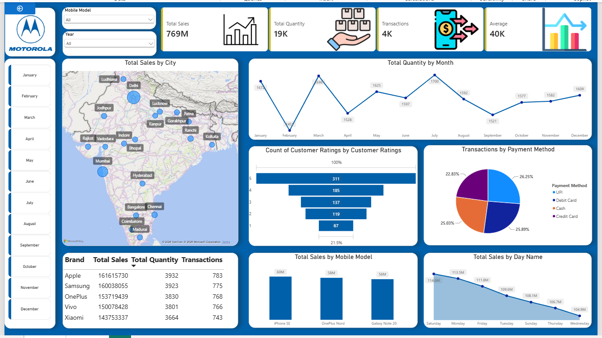

# Motorola Mobile Sales Dashboard

## Project Overview

This project uses Microsoft Power BI to analyze Motorola mobile sales data and present key business metrics through an interactive dashboard. It helps understand sales performance, customer preferences, and purchasing trends.

## Dashboard Features

- Sales Overview: Total sales, total quantity sold, total transactions, and average sales.
- City-wise Analysis: Geographic distribution of sales across cities.
- Monthly Trends: Quantity sold by month.
- Customer Ratings: Analysis of customer ratings.
- Payment Methods: Comparison of transactions by payment method.
- Brand Analysis: Comparison of sales and transactions across mobile brands.
- Mobile Model Analysis: Sales performance of individual mobile models.
- Day-wise Analysis: Sales trends by day of the week.

## Tools and Technologies

- Microsoft Power BI
- Data Visualization
- Business Intelligence
- Data Analysis

## Dashboard Preview

### Objective

To analyze mobile sales data, identify sales trends, compare brand and model performance, and understand customer purchasing preferences through interactive visualizations.

## Key Insights

Key business insights can be added here after analyzing the dashboard results.

## Author

Data Analyst Portfolio Project
